<div align="center">



</div>


<div align="center">

### .:*~*:._.:*~*:. ° sobre mí ° .:*~*:._.:*~*:.
 
</div>
```text
 .--------------------------------------------------.
 |  > creator content                               |
 |  > based in Barranquilla, Colombia               |
 |  > currently exploring: Modding                  |
 '--------------------------------------------------'
```
 

<div align="center">
### .:*~*:._.:*~*:. ° find me ° .:*~*:._.:*~*:.
 
<a href="https://www.youtube.com/@seikelomg"></a>
<a href="https://www.youtube.com/@seikeeelhack"></a>
<a href="https://x.com/seikelomg"></a>
<a href="https://www.instagram.com/seikelomg"></a>
 
</div>

<div align="center">

### .:*~*:._.:*~*:. ° tools ° .:*~*:._.:*~*:.


<br/>


</div>


<div align="center">


### .:*~*:._.:*~*:. ° stats ° .:*~*:._.:*~*:.
 


</div>


<div align="center">

### .:*~*:._.:*~*:. ° contributions ° .:*~*:._.:*~*:.


</div>


